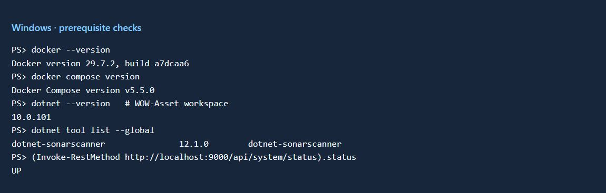
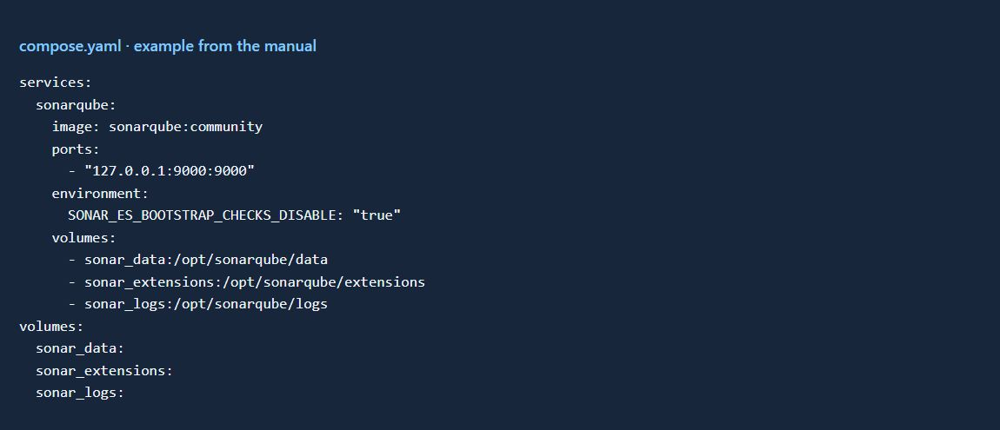
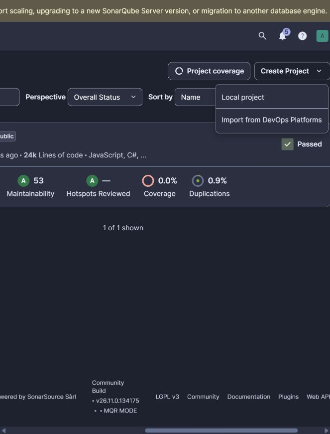
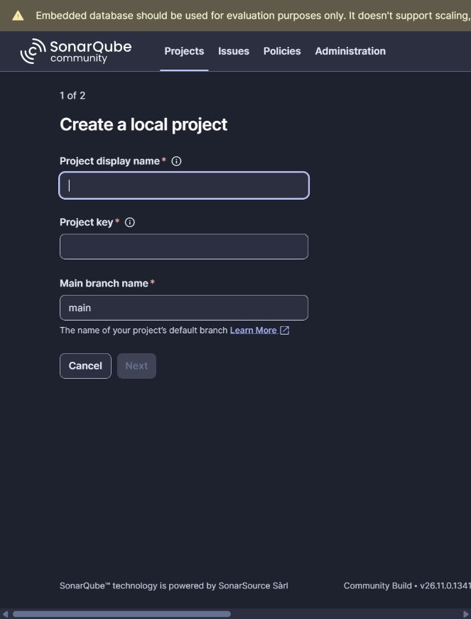
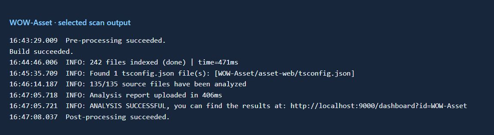
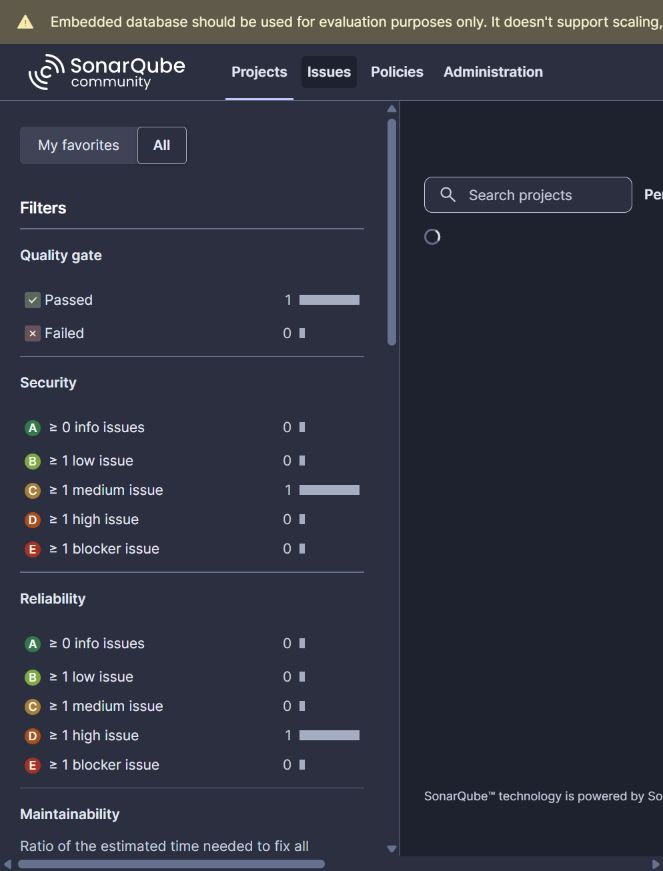
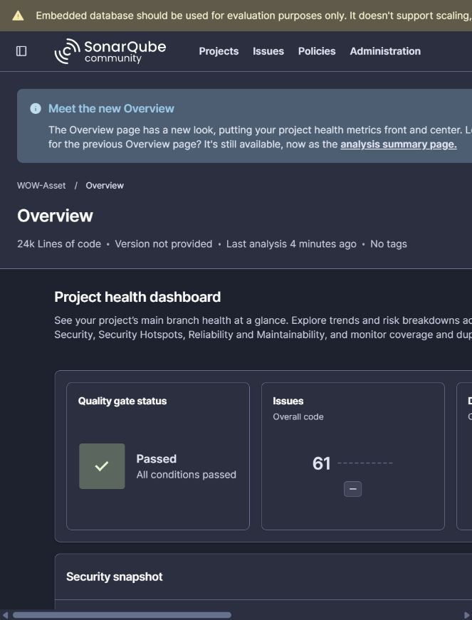

# AI runbook for SonarQube / คู่มือสำหรับ AI เพื่อติดตั้งและสแกน SonarQube

## English — instructions for the AI

Use this runbook when the user asks you to install local SonarQube and scan a repository. Follow the user's authorization and the repository's instructions. The companion [manual](SONARQUBE_MANUAL_EN_TH.md) contains the shared Compose configuration and user-facing setup steps.

### 1. Inspect before acting

**Start here.** Open http://localhost:9000/api/system/status. If it returns `UP`, reuse that server and continue at step 4. For a first installation, complete steps 1–3 in order. Docker hosts the server. The scanner runs on the machine that has the source code.




Identify the operating system, CPU architecture, repository root, requested project, existing SonarQube server, and chosen port. Read `global.json` and the target `.csproj` or `.sln`.

Check Docker containers, images and volumes without exposing environment variables or secrets.

```sh
docker version
docker compose version
docker ps -a --format "{{.Names}} | {{.Image}} | {{.Ports}}"
docker volume ls
dotnet --list-sdks
dotnet --version
dotnet tool list --global
```

If Docker is stopped for data recovery, obtain the user's explicit decision that recovery is finished before starting it. Check the current recovery status with the owner if recovery is in progress.

Preserve existing containers, volumes, database files, scan exports, and credentials. An installation or scanning request does not authorize deleting history, resetting passwords, uninstalling software, or upgrading an existing server. Never run `-ResetSonarData`, `docker compose down -v`, volume-pruning commands, or factory resets under this task. Obtain separate explicit authorization naming the data if deletion is requested later.

### 2. Install only missing prerequisites

- Download Docker Desktop from the official [Windows](https://docs.docker.com/desktop/setup/install/windows-install/) or [Mac](https://docs.docker.com/desktop/setup/install/mac-install/) page. Match CPU architecture. Complete the installer and OS prompts through permitted tools. If user interaction or elevation is genuinely required, explain the exact step needed and continue independent checks.
- Install a compatible .NET SDK based on `global.json`. This repository requests `9.0.308` with `latestFeature` roll-forward. Confirm `dotnet --version` succeeds from the repository root. Preserve `global.json`.
- Install SonarScanner only if missing. Reuse a working installed version rather than updating it automatically.

```sh
dotnet tool install --global dotnet-sonarscanner
```

On Mac, resolve the global tool directory in the current shell if necessary.

```sh
export PATH="$PATH:$HOME/.dotnet/tools"
```

### 3. Reuse or create a local server

From the folder containing the Compose file, run `docker compose config --quiet` to check the configuration. Success produces no output. Start the server using the commands below, check its published port with `docker compose ps`, then wait for `UP`.




If an existing compatible server is available, use its approved URL and project. Record its version and storage before any changes. If another service occupies port 9000, select an available port for the new isolated instance and report it. Preserve the existing service.

For a new local evaluation instance, create a separate directory and use the Compose configuration in the companion manual. Before writing, check that the file and associated project name are unused. The configuration binds localhost and stores data in named volumes. Download links are in the manual and on the [SonarQube website](https://www.sonarsource.com/products/sonarqube/downloads/).

Run from that directory only after the recovery precondition in step 1 is resolved.

```sh
docker compose pull
docker compose up -d
docker compose logs --tail 100 sonarqube
```

Wait for `GET /api/system/status` to report `UP` at the chosen URL. Poll at sensible intervals with a bounded timeout. If startup fails, inspect logs and address the actual cause without deleting storage or weakening unrelated system settings. Do not launch ZAP, JMeter or unrelated tools.

### 4. Create or select the project and credentials

**WOW-Asset example.** Open the existing project if it is already listed. For a new project, select **Create Project → Local project**. Enter a display name, the exact key your scanner will use, and the intended main branch name. Click **Next**, choose the new-code definition or inherit the server default, and create the project. Select **Locally → Provide a token → Generate → Continue → .NET → .NET Core**. Keep the token in the local private prompt.






Reuse the intended project if it exists. For a new server, complete initial login and password setup using credentials provided or entered privately by the user. A new project's **Locally → Generate → Continue → .NET** wizard provides the token and scan commands.

If automation is authorized and authenticated access is available, use the installed server's documented API to create the intended project and a narrowly scoped analysis token. Inspect that version's Web API documentation before calling mutation endpoints. Do not assume credentials, expose tokens in tool output, or copy passwords from example scripts. If access is missing, ask the user to complete login/token generation privately.

Keep secrets outside source files and exported evidence. Pass the token using `sonar.token` in both .NET scanner steps. The .NET scanner does not support the generic `SONAR_TOKEN` environment-variable shortcut. The examples below use a separately supplied environment variable to form the explicit scanner argument.

### 5. Scan the code

#### 5A. Any repository with a .NET API and Vue frontend

1. Open a terminal at the repository root (the folder containing both applications). Find the solution or API project, the API source folder, the Vue source folder and the project key you created in SonarQube.
2. Adapt the three commands below. Replace `PROJECT_KEY`, `ApiFolder`, `WebFolder/src`, `YourSolution.sln` and the server URL with the values for this repository. Use SonarScanner for .NET 8 or newer. Set the token privately in your terminal first.
3. Run one command at a time. Continue only when the previous command succeeds.
  
**PowerShell**
  
```powershell
dotnet sonarscanner begin /k:"PROJECT_KEY" /d:sonar.host.url="http://localhost:9000" /d:sonar.token="$env:SONAR_TOKEN" "/d:sonar.projectBaseDir=$PWD" /d:sonar.scanner.scanAll=true /d:sonar.inclusions="ApiFolder/**/*.cs,WebFolder/src/**/*.vue,WebFolder/src/**/*.ts,WebFolder/src/**/*.js,WebFolder/src/**/*.css"
dotnet build ./YourSolution.sln --configuration Release --no-incremental
dotnet sonarscanner end /d:sonar.token="$env:SONAR_TOKEN"
```

On macOS/Linux use `$SONAR_TOKEN` in place of `$env:SONAR_TOKEN`. Add other source or test folder patterns as needed. If the running API locks the output executable, use a separate build output, e.g. append `--artifacts-path "$env:TEMP/sonar-build"` to the build command in PowerShell with .NET SDK 8+.

4. After server processing, open **Code** and check a real `.cs` file and a real `.vue` file. For WOW-Asset use `WOW-Asset`, `Asset.sln`, `Asset.Api` and `asset-web/src`. Check `asset-web/src/components/AssetProfilePanel.vue`.

**Optional shortcut in the WOW-Asset checkout.** Run this instead of the three scan commands only if the file exists in that checkout:

```powershell
.\scripts\scan-sonarqube-local.ps1
```

For a standalone Vue app, choose **JS/TS & Web** in the wizard and run the generated web scanner command from the folder containing its `package.json`. For a combined analysis, the .NET sequence above already covers Vue.



#### 5B. Financial Accounting: scan the API


Record the source commit and existing working-tree changes. A scan request alone does not authorize fixing application code. For this project the target is `API/API.csproj`. Inspect existing helper scripts before using them. `scripts/phase4/install-tools.ps1` includes reset options and launches unrelated tools. `scripts/phase4/run-sonarqube-scan.ps1` does not reliably fail on every external-command error. Prefer the explicit commands below with individual exit-code checks.

The examples assume the user has privately supplied `SONAR_ANALYSIS_TOKEN` in the process environment. Replace the example project key and URL with the selected values. Never echo the secret or include it in a transcript. Each command is one line.

**Windows — PowerShell**

```powershell
dotnet sonarscanner begin /k:"financial-accounting-local" /d:sonar.host.url="http://localhost:9000" /d:sonar.token="$env:SONAR_ANALYSIS_TOKEN"
dotnet build API/API.csproj --no-incremental
dotnet sonarscanner end /d:sonar.token="$env:SONAR_ANALYSIS_TOKEN"
```

Run each command separately and check `$LASTEXITCODE` immediately. Continue only when it is zero. On failure, inspect the cause before retrying the complete sequence.

**Mac — Terminal**

```sh
dotnet sonarscanner begin /k:"financial-accounting-local" /d:sonar.host.url="http://localhost:9000" /d:sonar.token="$SONAR_ANALYSIS_TOKEN"
dotnet build API/API.csproj --no-incremental
dotnet sonarscanner end /d:sonar.token="$SONAR_ANALYSIS_TOKEN"
```

Run each command separately and check its exit status immediately. Continue only on success. Confirm the target builds on macOS. Adapt the build path for another repository.

### 6. Wait for processing and preserve evidence

Open **Projects → WOW-Asset → Overview** and check the analysis time and Quality Gate. In **Code**, look for a C# source file under `Asset.Api` and a Vue component under `asset-web/src`. If either is missing, check the working directory, scanAll and inclusions before scanning again. On 17 November 2026 the combined scan indexed 242 files. The gate passed with 61 issues across overall code. Coverage requires a separately generated and imported test report.





In the handoff, record the key, source scope, build exit status, upload result, server processing status, Quality Gate and dashboard link. Keep tokens out of logs and screenshots.


1. Read the compute-engine task URL or ID from scanner output or `report-task.txt`. Keep credentials out of logs.
2. Poll that exact task until `SUCCESS`, `FAILED`, or `CANCELED`. Report a timeout explicitly and continue monitoring when the user requested completion.
3. On success, use its analysis ID to retrieve the Quality Gate for that analysis. Retrieve project metrics and issues using the installed version's documented API. Follow pagination for a complete issue export. Account for concurrent scans when interpreting project-level metrics.
4. Save sanitized exports in a new timestamped evidence folder. Preserve prior folders. Include source commit, existing changes, server/scanner versions, project key, URL, task ID, analysis ID, timestamps, Quality Gate, and exported metrics/issues. Coverage needs a real test coverage report and correct import settings.
5. Distinguish upload success, server processing success, and Quality Gate status in the final reply. Link to the dashboard and saved evidence. State any remaining limitations.
6. Leave persistent data intact. Stop the newly created container only if requested or agreed. Avoid stopping unrelated containers or the Docker engine.

## ภาษาไทย — คำสั่งสำหรับ AI

ใช้คู่มือนี้เมื่อผู้ใช้ขอให้ติดตั้ง SonarQube บนเครื่องและสแกน repository ปฏิบัติตามขอบเขตที่ผู้ใช้อนุญาตและคำสั่งของ repository ส่วน [คู่มือสำหรับผู้ใช้](SONARQUBE_MANUAL_EN_TH.md) มีไฟล์ Compose และขั้นตอนตั้งค่าที่ใช้ร่วมกัน

### 1. ตรวจสอบก่อนดำเนินการ

**เริ่มที่นี่** เปิด http://localhost:9000/api/system/status หากเห็น `UP` ให้ใช้เซิร์ฟเวอร์เดิมและไปขั้นตอน 4 หากกำลังติดตั้งครั้งแรก ให้ทำขั้นตอน 1–3 ตามลำดับ Docker รันเซิร์ฟเวอร์ ส่วน scanner ทำงานบนเครื่องที่มีซอร์สโค้ด


ระบุระบบปฏิบัติการ สถาปัตยกรรม CPU โฟลเดอร์หลักของ repository โปรเจกต์ที่ต้องสแกน เซิร์ฟเวอร์ SonarQube เดิม และพอร์ต อ่าน `global.json` และไฟล์ `.csproj` หรือ `.sln` ที่เกี่ยวข้อง

ตรวจสอบ Docker โดยไม่แสดง environment variables หรือข้อมูลลับ

```sh
docker version
docker compose version
docker ps -a --format "{{.Names}} | {{.Image}} | {{.Ports}}"
docker volume ls
dotnet --list-sdks
dotnet --version
dotnet tool list --global
```

หากหยุด Docker เพื่อกู้ข้อมูล ต้องให้ผู้ใช้ยืนยันว่าการกู้ข้อมูลเสร็จแล้วก่อนเปิด Docker หากกำลังกู้ข้อมูล ให้ตรวจสอบสถานะล่าสุดกับผู้ดูแลก่อนเปิด Docker

เก็บ container, volume, ฐานข้อมูล, ผลสแกนที่ส่งออก และข้อมูลรับรองเดิมไว้ คำขอติดตั้งหรือสแกนไม่ได้อนุญาตให้ลบประวัติ รีเซ็ตรหัสผ่าน ถอนโปรแกรม หรืออัปเกรดเซิร์ฟเวอร์เดิม ห้ามใช้ `-ResetSonarData`, `docker compose down -v`, คำสั่ง prune volume หรือ factory reset ในงานนี้ หากมีคำขอลบในภายหลัง ต้องได้รับอนุญาตแยกโดยระบุข้อมูลที่จะลบอย่างชัดเจน

### 2. ติดตั้งเฉพาะสิ่งที่ยังขาด

- ดาวน์โหลด Docker Desktop จากเว็บไซต์ทางการสำหรับ [Windows](https://docs.docker.com/desktop/setup/install/windows-install/) หรือ [Mac](https://docs.docker.com/desktop/setup/install/mac-install/) เลือก CPU ให้ตรง ใช้เครื่องมือที่ได้รับอนุญาตเพื่อดำเนินการติดตั้ง หากต้องให้ผู้ใช้โต้ตอบหรือใช้สิทธิ์ผู้ดูแลจริง ๆ ให้แจ้งขั้นตอนที่ต้องทำและตรวจสอบส่วนอื่นต่อระหว่างรอ
- ติดตั้ง .NET SDK ตาม `global.json` โปรเจกต์นี้ระบุ `9.0.308` และ `latestFeature` roll-forward ตรวจสอบว่า `dotnet --version` ทำงานจากโฟลเดอร์หลักได้ เก็บ `global.json` เดิมไว้
- ติดตั้ง SonarScanner เมื่อยังไม่มี หากเวอร์ชันเดิมใช้งานได้ให้ใช้ต่อ

```sh
dotnet tool install --global dotnet-sonarscanner
```

บน Mac หากจำเป็นให้เพิ่มตำแหน่ง global tool ใน shell ปัจจุบัน

```sh
export PATH="$PATH:$HOME/.dotnet/tools"
```

### 3. ใช้เซิร์ฟเวอร์เดิมหรือสร้างเซิร์ฟเวอร์ใหม่

ตรวจไฟล์ก่อนเริ่มเซิร์ฟเวอร์: จากโฟลเดอร์ Compose รัน `docker compose config --quiet` เมื่อสำเร็จจะไม่มีข้อความ จากนั้นใช้คำสั่งเริ่มระบบด้านล่าง ตรวจพอร์ตด้วย `docker compose ps` และรอให้สถานะเป็น `UP`


หากมีเซิร์ฟเวอร์ที่เข้ากันได้ ให้ใช้ URL และโปรเจกต์ที่ได้รับอนุญาต บันทึกเวอร์ชันและตำแหน่งข้อมูลก่อนเปลี่ยนแปลง หากพอร์ต 9000 ถูกใช้อยู่ ให้เลือกพอร์ตว่างสำหรับชุดใหม่และแจ้งผู้ใช้ เก็บบริการเดิมไว้

สำหรับชุดทดลองใหม่ ให้สร้างโฟลเดอร์แยกและใช้ไฟล์ Compose จากคู่มือสำหรับผู้ใช้ ตรวจสอบก่อนว่าไฟล์และชื่อโปรเจกต์ Docker ยังไม่ถูกใช้งาน การตั้งค่าจะเปิดเฉพาะ localhost และเก็บข้อมูลใน named volumes ดาวน์โหลด SonarQube ได้จาก [เว็บไซต์ทางการ](https://www.sonarsource.com/products/sonarqube/downloads/)

เมื่อเงื่อนไขการกู้ข้อมูลในขั้นตอนที่ 1 ได้รับการแก้ไขแล้ว ให้รันจากโฟลเดอร์ดังกล่าว

```sh
docker compose pull
docker compose up -d
docker compose logs --tail 100 sonarqube
```

รอให้ `GET /api/system/status` ของ URL ที่เลือกคืนสถานะ `UP` ตรวจเป็นระยะและกำหนดเวลารอ หากเปิดไม่สำเร็จ ให้อ่าน log และแก้สาเหตุจริงโดยเก็บข้อมูลไว้ หลีกเลี่ยงการเปลี่ยนการตั้งค่าระบบที่ไม่เกี่ยวข้อง และไม่เปิด ZAP, JMeter หรือเครื่องมืออื่นนอกงาน

### 4. เลือกโปรเจกต์และเตรียมข้อมูลรับรอง

**ตัวอย่าง WOW-Asset** หากมีโปรเจกต์แล้ว ให้เปิดรายการเดิม หากสร้างใหม่ เลือก **Create Project → Local project** กรอกชื่อที่แสดงและ project key ใช้ key เดียวกับคำสั่งสแกน กรอกชื่อ main branch จริงของโปรเจกต์ กด **Next** เลือกนิยาม New Code หรือใช้ค่าของเซิร์ฟเวอร์ แล้วสร้างโปรเจกต์ เลือก **Locally → Provide a token → Generate → Continue → .NET → .NET Core** เก็บ token ไว้ในช่องรับค่าลับของเครื่อง


หากมีโปรเจกต์เป้าหมายอยู่แล้ว ให้ใช้โปรเจกต์นั้น สำหรับเซิร์ฟเวอร์ใหม่ ให้เข้าสู่ระบบและตั้งรหัสผ่านด้วยข้อมูลที่ผู้ใช้ให้หรือกรอกเองเป็นการส่วนตัว หน้าตั้งค่าโปรเจกต์ **Locally → Generate → Continue → .NET** จะแสดง token และคำสั่งสแกน

หากได้รับอนุญาตให้ทำอัตโนมัติและมีสิทธิ์ที่จำเป็น สามารถใช้ API ของเวอร์ชันที่ติดตั้งเพื่อสร้างโปรเจกต์และ analysis token ที่มีขอบเขตเหมาะสมได้ อ่าน Web API documentation ของเซิร์ฟเวอร์ก่อนเรียก API ที่เปลี่ยนข้อมูล ห้ามเดารหัสผ่าน แสดง token ในผลเครื่องมือ หรือคัดลอกรหัสผ่านจากสคริปต์ตัวอย่าง หากยังไม่มีสิทธิ์ ให้ผู้ใช้เข้าสู่ระบบและสร้าง token เป็นการส่วนตัว

เก็บข้อมูลลับไว้นอก source code และไฟล์หลักฐาน ใช้ `sonar.token` ทั้งตอน begin และ end ของ .NET scanner เนื่องจาก .NET scanner ไม่รองรับวิธีใช้ตัวแปร `SONAR_TOKEN` โดยตรง ตัวอย่างต่อไปนี้ใช้ environment variable อีกชื่อหนึ่งเพื่อส่งค่าเป็น argument อย่างชัดเจน

### 5. สแกนซอร์สโค้ด

#### 5A. สำหรับ repository ที่มีทั้ง API .NET และเว็บ Vue

1. เปิดเทอร์มินัลที่โฟลเดอร์รากซึ่งมีทั้ง API และเว็บ หาไฟล์ solution หรือโปรเจกต์ API โฟลเดอร์ซอร์สของ API และ Vue รวมถึง project key ที่สร้างใน SonarQube
2. แทนค่า `PROJECT_KEY`, `ApiFolder`, `WebFolder/src`, `YourSolution.sln` และ URL ด้วยค่าของโปรเจกต์จริง ใช้ SonarScanner for .NET รุ่น 8 ขึ้นไป ตั้งค่า token ในเทอร์มินัลเป็นการส่วนตัวก่อนเริ่ม
3. รันทีละคำสั่ง ไปต่อเมื่อคำสั่งก่อนหน้าสำเร็จ
  
**PowerShell**
  
```powershell
dotnet sonarscanner begin /k:"PROJECT_KEY" /d:sonar.host.url="http://localhost:9000" /d:sonar.token="$env:SONAR_TOKEN" "/d:sonar.projectBaseDir=$PWD" /d:sonar.scanner.scanAll=true /d:sonar.inclusions="ApiFolder/**/*.cs,WebFolder/src/**/*.vue,WebFolder/src/**/*.ts,WebFolder/src/**/*.js,WebFolder/src/**/*.css"
dotnet build ./YourSolution.sln --configuration Release --no-incremental
dotnet sonarscanner end /d:sonar.token="$env:SONAR_TOKEN"
```

บน macOS/Linux ให้ใช้ `$SONAR_TOKEN` แทน `$env:SONAR_TOKEN` เพิ่มรูปแบบโฟลเดอร์ซอร์สหรือเทสต์อื่นตามจริง หาก API ที่เปิดอยู่ล็อกไฟล์ ให้เพิ่ม `--artifacts-path "$env:TEMP/sonar-build"` ในคำสั่ง build บน PowerShell เมื่อใช้ .NET SDK 8 ขึ้นไป

4. เมื่อประมวลผลเสร็จ เปิด **Code** ตรวจว่าเห็นทั้งไฟล์ `.cs` และ `.vue` จริง ตัวอย่าง WOW-Asset ใช้ `WOW-Asset`, `Asset.sln`, `Asset.Api` และ `asset-web/src` ตรวจไฟล์ `asset-web/src/components/AssetProfilePanel.vue`

**ทางลัดสำหรับ WOW-Asset เท่านั้น** เมื่ออยู่ที่รากของ WOW-Asset และมีไฟล์นี้ ให้ใช้แทนสามคำสั่งด้านบน:

```powershell
.\scripts\scan-sonarqube-local.ps1
```

หากโปรเจกต์มีเฉพาะ Vue ให้เลือก **JS/TS & Web** แล้วรันคำสั่งที่หน้าจอแสดงจากโฟลเดอร์ที่มี `package.json` สำหรับการสแกนรวม ขั้นตอน .NET ข้างต้นครอบคลุม Vue แล้ว


#### 5B. Financial Accounting: สแกน API


บันทึก commit และไฟล์ที่แก้ไว้ก่อนเริ่ม คำขอสแกนอย่างเดียวไม่ได้อนุญาตให้แก้โค้ดแอป โปรเจกต์นี้ใช้ `API/API.csproj` อ่านสคริปต์เดิมก่อนเรียกใช้ โดย `scripts/phase4/install-tools.ps1` มีตัวเลือกรีเซ็ตข้อมูลและเปิดเครื่องมืออื่น ส่วน `scripts/phase4/run-sonarqube-scan.ps1` ไม่ตรวจข้อผิดพลาดของ external command ได้ครบทุกกรณี ให้ใช้คำสั่งแยกด้านล่างและตรวจผลแต่ละคำสั่ง

ตัวอย่างสมมติว่าผู้ใช้ส่ง `SONAR_ANALYSIS_TOKEN` ให้ผ่าน process environment เป็นการส่วนตัวแล้ว เปลี่ยน project key และ URL ตามที่เลือก ห้าม echo ข้อมูลลับหรือใส่ใน transcript แต่ละคำสั่งเป็นหนึ่งบรรทัด

**Windows — PowerShell**

```powershell
dotnet sonarscanner begin /k:"financial-accounting-local" /d:sonar.host.url="http://localhost:9000" /d:sonar.token="$env:SONAR_ANALYSIS_TOKEN"
dotnet build API/API.csproj --no-incremental
dotnet sonarscanner end /d:sonar.token="$env:SONAR_ANALYSIS_TOKEN"
```

รันทีละคำสั่งและตรวจ `$LASTEXITCODE` ทันที ทำขั้นตอนถัดไปเมื่อค่าเป็นศูนย์ หากล้มเหลวให้ตรวจสาเหตุก่อนเริ่มลำดับใหม่ทั้งหมด

**Mac — Terminal**

```sh
dotnet sonarscanner begin /k:"financial-accounting-local" /d:sonar.host.url="http://localhost:9000" /d:sonar.token="$SONAR_ANALYSIS_TOKEN"
dotnet build API/API.csproj --no-incremental
dotnet sonarscanner end /d:sonar.token="$SONAR_ANALYSIS_TOKEN"
```

รันทีละคำสั่งและตรวจ exit status ทันที ทำต่อเมื่อสำเร็จ ตรวจว่าโปรเจกต์ build บน macOS ได้ และเปลี่ยนตำแหน่งไฟล์ build หากเป็น repository อื่น

### 6. รอประมวลผลและเก็บหลักฐาน

เปิด **Projects → WOW-Asset → Overview** ตรวจเวลาที่สแกนและ Quality Gate จากนั้นเปิด **Code** ตรวจตัวอย่างไฟล์ C# ใน `Asset.Api` และ Vue ใน `asset-web/src` ถ้ามีเพียงฝั่งเดียว ให้ตรวจโฟลเดอร์ที่เริ่มสแกน การตั้งค่า scanAll และ inclusions ก่อนสแกนใหม่ ตัวอย่างวันที่ 17 พ.ย. 2026 มี 242 ไฟล์ในดัชนี Quality Gate ผ่าน และมี 61 issues บนโค้ดทั้งหมด ค่า coverage ต้องนำเข้าจากรายงานทดสอบ


รายงานสำหรับผู้ใช้ให้ระบุ project key, ขอบเขตไฟล์, ผล build, ผล upload, สถานะการประมวลผล และ Quality Gate พร้อมลิงก์แดชบอร์ด ปิดบัง token ในภาพและบันทึกทุกครั้ง


1. อ่าน URL หรือ ID ของ compute-engine task จาก scanner output หรือ `report-task.txt` โดยเก็บข้อมูลรับรองออกจาก log
2. ตรวจ task นั้นจนได้ `SUCCESS`, `FAILED` หรือ `CANCELED` หากหมดเวลารอให้ระบุชัด และติดตามต่อเมื่อผู้ใช้ขอให้รอจนเสร็จ
3. เมื่อสำเร็จ ใช้ analysis ID เพื่ออ่าน Quality Gate ของผลครั้งนั้น อ่าน metrics และ issues ผ่าน API ของเวอร์ชันที่ติดตั้ง ดึงข้อมูลทุกหน้าให้ครบ และคำนึงถึงการสแกนพร้อมกันเมื่อใช้ metrics ระดับโปรเจกต์
4. บันทึกผลที่ตัดข้อมูลลับออกในโฟลเดอร์หลักฐานใหม่พร้อมเวลา เก็บโฟลเดอร์เดิมไว้ ระบุ commit, ไฟล์ที่แก้ค้างอยู่, เวอร์ชันเซิร์ฟเวอร์และ scanner, project key, URL, task ID, analysis ID, เวลา, Quality Gate และ metrics/issues ส่วน coverage ต้องมีรายงานการทดสอบจริงและตั้งค่าการนำเข้าให้ถูกต้อง
5. รายงานสถานะการส่งข้อมูล สถานะประมวลผล และ Quality Gate แยกให้ชัด พร้อมลิงก์ dashboard และไฟล์หลักฐาน ระบุข้อจำกัดที่ยังมีอยู่
6. เก็บข้อมูลถาวรไว้ หยุด container ใหม่เมื่อผู้ใช้ขอหรือตกลงไว้ หลีกเลี่ยงการหยุด container อื่นหรือ Docker engine

## Official references / เอกสารอ้างอิง

- [SonarQube project setup](https://docs.sonarsource.com/sonarqube-community-build/try-out-sonarqube)
- [SonarScanner for .NET](https://docs.sonarsource.com/sonarqube-community-build/analyzing-source-code/scanners/dotnet/using)
- [Analysis parameters and token support](https://docs.sonarsource.com/sonarqube-community-build/analyzing-source-code/analysis-parameters/parameters-not-settable-in-ui)
- API documentation is available through the installed server's Web API link. / เปิดเอกสาร API ได้จากลิงก์ Web API ของเซิร์ฟเวอร์ที่ติดตั้ง
