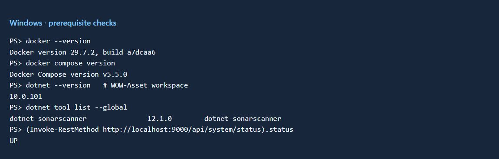
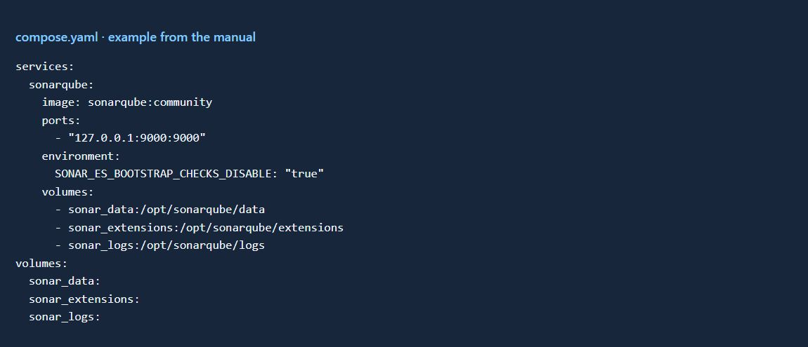
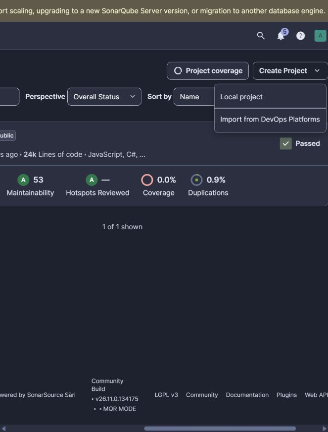
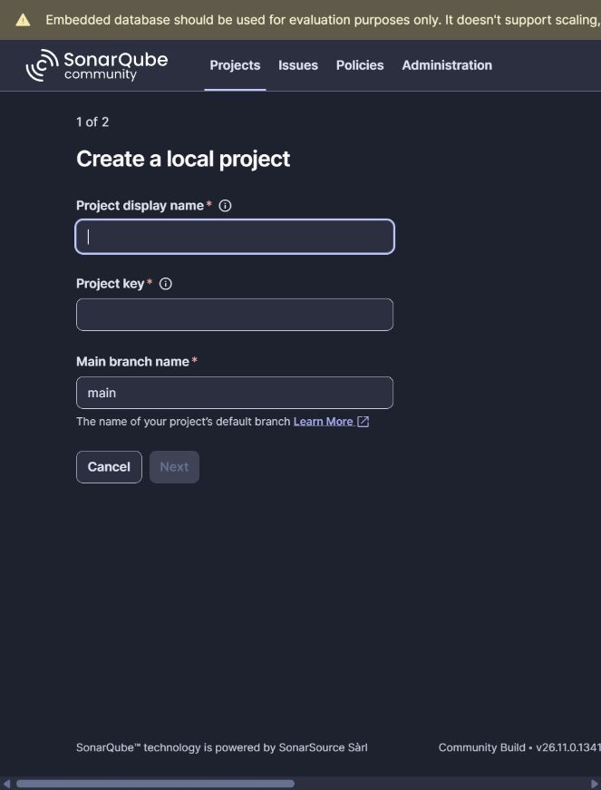
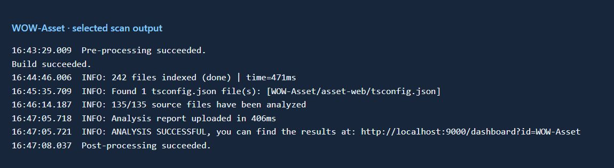
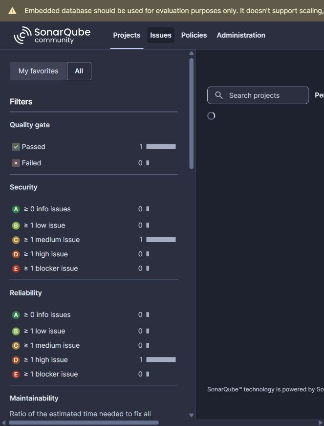
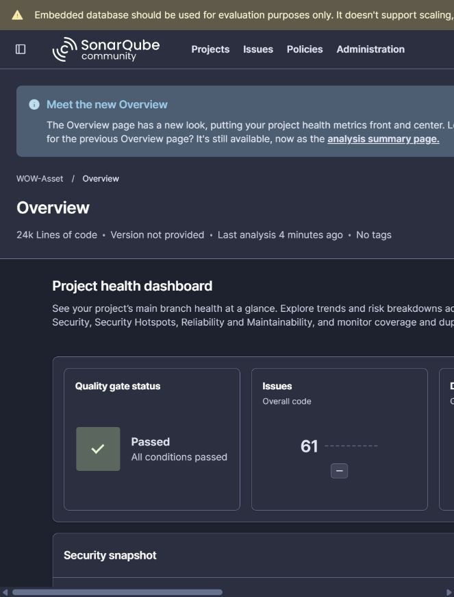

# SonarQube installation and scanning / คู่มือติดตั้งและสแกน SonarQube

## English

For local use on Windows and Mac. The scanning example uses this project's .NET API. Follow the steps below in order.

### 1. Download Docker and SonarQube

**Start here.** Open http://localhost:9000/api/system/status. If it returns `UP`, reuse that server and continue at step 4. For a first installation, complete steps 1–3 in order. Docker hosts the server. The scanner runs on the machine that has the source code.




| Download | Link |
|---|---|
| Docker Desktop for Windows | [Download](https://docs.docker.com/desktop/setup/install/windows-install/) |
| Docker Desktop for Mac | [Download](https://docs.docker.com/desktop/setup/install/mac-install/) |
| SonarQube Community Build | [Official downloads](https://www.sonarsource.com/products/sonarqube/downloads/) |
| .NET SDK | [Download](https://dotnet.microsoft.com/download) |

Windows users with Intel or AMD x64 processors should choose AMD64. On Mac, check **Apple menu → About This Mac**, then choose Apple silicon or Intel to match your computer.

Install and open Docker Desktop. Wait for the engine to start. This guide downloads SonarQube through Docker in step 3, so a separate ZIP download is unnecessary.

Open **PowerShell** on Windows or **Terminal** on Mac and check Docker.

```sh
docker version
docker compose version
```

If SonarQube already exists, preserve its containers and volumes. Use the existing server or a separate setup folder and port. If Docker was stopped for data recovery, finish that recovery before starting Docker.

### 2. Create a Compose file

Use a new folder. If a file with this name already exists, inspect it before editing.

**Windows — PowerShell**

```powershell
New-Item -ItemType Directory -Force "$HOME/sonarqube-local"
Set-Location "$HOME/sonarqube-local"
notepad compose.yaml
```

**Mac — Terminal**

```sh
mkdir -p ~/sonarqube-local
cd ~/sonarqube-local
nano compose.yaml
```

Paste this content. It is the same for both systems.

```yaml
services:
  sonarqube:
    image: sonarqube:community
    ports:
      - "127.0.0.1:9000:9000"
    environment:
      SONAR_ES_BOOTSTRAP_CHECKS_DISABLE: "true"
    volumes:
      - sonar_data:/opt/sonarqube/data
      - sonar_extensions:/opt/sonarqube/extensions
      - sonar_logs:/opt/sonarqube/logs
volumes:
  sonar_data:
  sonar_extensions:
  sonar_logs:
```

On Windows, save as **compose.yaml** using **All files** in Notepad. On Mac, press **Control+O → Return → Control+X** in nano.

This is a local evaluation setup using the embedded database and disabled Elasticsearch bootstrap checks. The volumes retain your analysis data. The `community` tag follows the published Community image. Record the installed version and follow Sonar's upgrade guidance before changing an existing installation.

### 3. Download and run SonarQube

From the folder containing the Compose file, run `docker compose config --quiet` to check the configuration. Success produces no output. Start the server using the commands below, check its published port with `docker compose ps`, then wait for `UP`.




Run from the folder containing `compose.yaml` on either system.

```sh
docker compose pull
docker compose up -d
docker compose logs -f sonarqube
```

Wait for **SonarQube is operational**, then press **Control+C** to stop watching the logs. SonarQube keeps running.

Open [http://localhost:9000](http://localhost:9000). If port 9000 is occupied, use `"127.0.0.1:9002:9000"` in the file, run `docker compose up -d` again, and use port 9002 in the browser and scan commands.

### 4. Create a local project and generate a token

**WOW-Asset example.** Open the existing project if it is already listed. For a new project, select **Create Project → Local project**. Enter a display name, the exact key your scanner will use, and the intended main branch name. Click **Next**, choose the new-code definition or inherit the server default, and create the project. Select **Locally → Provide a token → Generate → Continue → .NET → .NET Core**. Keep the token in the local private prompt.






1. For a new server, sign in with `admin` as both username and password. Set a new password when prompted.
2. Select **Projects → Create project → Create a local project**. Labels may vary by version.
3. Enter a name and project key, for example `financial-accounting-local`. For an existing project, open it instead.
4. Choose **Locally**.
5. Under **Provide a token**, click **Generate → Continue**.
6. Select **.NET** and the option matching your project. SonarQube shows the scan commands with your project key and generated token.

An Azure DevOps personal access token is unnecessary for this local workflow. The SonarQube analysis token is generated when you click **Generate** during project setup. Starting the server on port 9000 does not generate a token. Keep the token private.

### 5. Scan the code

#### 5A. Any repository with a .NET API and Vue frontend

1. Open a terminal at the repository root (the folder containing both applications). Find the solution or API project, the API source folder, the Vue source folder and the project key you created in SonarQube.
2. Adapt the three commands below. Replace `PROJECT_KEY`, `ApiFolder`, `WebFolder/src`, `YourSolution.sln` and the server URL with the values for this repository. Use SonarScanner for .NET 8 or newer. Set the token privately in your terminal first.
3. Run one command at a time. Continue only when the previous command succeeds.
  
**PowerShell**
  
```powershell
dotnet sonarscanner begin /k:"PROJECT_KEY" /d:sonar.host.url="http://localhost:9000" /d:sonar.token="$env:SONAR_TOKEN" "/d:sonar.projectBaseDir=$PWD" /d:sonar.scanner.scanAll=true /d:sonar.inclusions="ApiFolder/**/*.cs,WebFolder/src/**/*.vue,WebFolder/src/**/*.ts,WebFolder/src/**/*.js,WebFolder/src/**/*.css"
dotnet build ./YourSolution.sln --configuration Release --no-incremental
dotnet sonarscanner end /d:sonar.token="$env:SONAR_TOKEN"
```

On macOS/Linux use `$SONAR_TOKEN` in place of `$env:SONAR_TOKEN`. Add other source or test folder patterns as needed. If the running API locks the output executable, use a separate build output, e.g. append `--artifacts-path "$env:TEMP/sonar-build"` to the build command in PowerShell with .NET SDK 8+.

4. After server processing, open **Code** and check a real `.cs` file and a real `.vue` file. For WOW-Asset use `WOW-Asset`, `Asset.sln`, `Asset.Api` and `asset-web/src`. Check `asset-web/src/components/AssetProfilePanel.vue`.

**Optional shortcut in the WOW-Asset checkout.** Run this instead of the three scan commands only if the file exists in that checkout:

```powershell
.\scripts\scan-sonarqube-local.ps1
```

For a standalone Vue app, choose **JS/TS & Web** in the wizard and run the generated web scanner command from the folder containing its `package.json`. For a combined analysis, the .NET sequence above already covers Vue.



#### 5B. Financial Accounting: scan the API


Open a terminal at the root of your code repository. Install the SDK requested by `global.json`. In this project it requests **9.0.308** with `latestFeature` roll-forward. Check resolution from the repository root.

```sh
dotnet --version
dotnet tool list --global
```

If SonarScanner is missing, install it once.

```sh
dotnet tool install --global dotnet-sonarscanner
```

On Mac, if the scanner command cannot be found, run this in the same terminal.

```sh
export PATH="$PATH:$HOME/.dotnet/tools"
```

Copy the **begin → build → end** commands shown by SonarQube. Run them one at a time, continuing only after each succeeds. The following shows their structure and works in PowerShell and Mac Terminal. Replace `YOUR_PROJECT_KEY` and `YOUR_SONAR_TOKEN` privately, or use the complete commands from the setup screen. Each command is one line.

```sh
dotnet sonarscanner begin /k:"YOUR_PROJECT_KEY" /d:sonar.host.url="http://localhost:9000" /d:sonar.token="YOUR_SONAR_TOKEN"
dotnet build API/API.csproj --no-incremental
dotnet sonarscanner end /d:sonar.token="YOUR_SONAR_TOKEN"
```

For another repository, replace `API/API.csproj` with its project or solution path. Mac scanning requires a project that builds on macOS. If a command fails, fix the reported cause and restart the full sequence.

### 6. View results and stop safely

Open **Projects → WOW-Asset → Overview** and check the analysis time and Quality Gate. In **Code**, look for a C# source file under `Asset.Api` and a Vue component under `asset-web/src`. If either is missing, check the working directory, scanAll and inclusions before scanning again. On 17 November 2026 the combined scan indexed 242 files. The gate passed with 61 issues across overall code. Coverage requires a separately generated and imported test report.






Open the project dashboard and wait for server processing to finish. Check the issues, metrics, and Quality Gate. A completed upload can still produce a failed Quality Gate. Coverage requires a separately generated test coverage report.

From your Compose folder, use these commands on either system.

```sh
docker compose stop
docker compose start
docker compose ps
```

**Preserve saved data.** Stop the server when finished. Deleting volumes erases analysis history. Avoid `docker compose down -v`, `docker volume rm`, `docker volume prune`, and factory resets when retaining results.

## ภาษาไทย

คู่มือนี้ใช้สำหรับ Windows และ Mac บนเครื่องของคุณ โดยตัวอย่างการสแกนใช้ .NET API ของโปรเจกต์นี้ ให้ทำตามลำดับด้านล่าง

### 1. ดาวน์โหลด Docker และ SonarQube

**เริ่มที่นี่** เปิด http://localhost:9000/api/system/status หากเห็น `UP` ให้ใช้เซิร์ฟเวอร์เดิมและไปขั้นตอน 4 หากกำลังติดตั้งครั้งแรก ให้ทำขั้นตอน 1–3 ตามลำดับ Docker รันเซิร์ฟเวอร์ ส่วน scanner ทำงานบนเครื่องที่มีซอร์สโค้ด


| โปรแกรม | ลิงก์ |
|---|---|
| Docker Desktop สำหรับ Windows | [ดาวน์โหลด](https://docs.docker.com/desktop/setup/install/windows-install/) |
| Docker Desktop สำหรับ Mac | [ดาวน์โหลด](https://docs.docker.com/desktop/setup/install/mac-install/) |
| SonarQube Community Build | [เว็บไซต์ดาวน์โหลดอย่างเป็นทางการ](https://www.sonarsource.com/products/sonarqube/downloads/) |
| .NET SDK | [ดาวน์โหลด](https://dotnet.microsoft.com/download) |

Windows ที่ใช้ Intel หรือ AMD แบบ x64 ให้เลือก AMD64 ส่วน Mac ให้ดูที่ **เมนู Apple → About This Mac** แล้วเลือก Apple silicon หรือ Intel ให้ตรงกับเครื่อง

ติดตั้งและเปิด Docker Desktop รอให้พร้อมใช้งาน คู่มือนี้จะดาวน์โหลด SonarQube ผ่าน Docker ในขั้นตอนที่ 3 จึงไม่ต้องดาวน์โหลด ZIP แยก

เปิด **PowerShell** บน Windows หรือ **Terminal** บน Mac แล้วตรวจสอบ

```sh
docker version
docker compose version
```

หากมี SonarQube อยู่แล้ว ให้เก็บ container และ volume เดิมไว้ ใช้เซิร์ฟเวอร์เดิมหรือสร้างชุดทดสอบแยกด้วยโฟลเดอร์และพอร์ตอื่น หากหยุด Docker เพื่อกู้ข้อมูล ให้ดำเนินการกู้ข้อมูลให้เสร็จก่อนเปิด Docker

### 2. สร้างไฟล์ Compose

ใช้โฟลเดอร์ใหม่ หากมีไฟล์ชื่อนี้อยู่แล้ว ให้ตรวจสอบก่อนแก้ไข

**Windows — PowerShell**

```powershell
New-Item -ItemType Directory -Force "$HOME/sonarqube-local"
Set-Location "$HOME/sonarqube-local"
notepad compose.yaml
```

**Mac — Terminal**

```sh
mkdir -p ~/sonarqube-local
cd ~/sonarqube-local
nano compose.yaml
```

วางเนื้อหาต่อไปนี้ ใช้เหมือนกันทั้งสองระบบ

```yaml
services:
  sonarqube:
    image: sonarqube:community
    ports:
      - "127.0.0.1:9000:9000"
    environment:
      SONAR_ES_BOOTSTRAP_CHECKS_DISABLE: "true"
    volumes:
      - sonar_data:/opt/sonarqube/data
      - sonar_extensions:/opt/sonarqube/extensions
      - sonar_logs:/opt/sonarqube/logs
volumes:
  sonar_data:
  sonar_extensions:
  sonar_logs:
```

Windows ให้บันทึกชื่อ **compose.yaml** โดยเลือก **All files** ใน Notepad ส่วน Mac ให้กด **Control+O → Return → Control+X** ใน nano

การตั้งค่านี้เหมาะสำหรับทดลองบนเครื่อง ใช้ฐานข้อมูลในตัวและปิด Elasticsearch bootstrap checks ส่วน volume ใช้เก็บข้อมูลการวิเคราะห์ แท็ก `community` อ้างอิงอิมเมจ Community ที่เผยแพร่อยู่ ให้จดเวอร์ชันที่ติดตั้งและตรวจสอบขั้นตอนอัปเกรดของ Sonar ก่อนเปลี่ยนระบบเดิม

### 3. ดาวน์โหลดและเปิด SonarQube

ตรวจไฟล์ก่อนเริ่มเซิร์ฟเวอร์: จากโฟลเดอร์ Compose รัน `docker compose config --quiet` เมื่อสำเร็จจะไม่มีข้อความ จากนั้นใช้คำสั่งเริ่มระบบด้านล่าง ตรวจพอร์ตด้วย `docker compose ps` และรอให้สถานะเป็น `UP`


รันจากโฟลเดอร์ที่มีไฟล์ `compose.yaml` ใช้คำสั่งเดียวกันทั้งสองระบบ

```sh
docker compose pull
docker compose up -d
docker compose logs -f sonarqube
```

รอข้อความ **SonarQube is operational** แล้วกด **Control+C** เพื่อออกจากการดู log โดยเซิร์ฟเวอร์ยังทำงานต่อ

เปิด [http://localhost:9000](http://localhost:9000) หากพอร์ต 9000 ถูกใช้อยู่ ให้เปลี่ยนเป็น `"127.0.0.1:9002:9000"` แล้วรัน `docker compose up -d` อีกครั้ง จากนั้นใช้พอร์ต 9002 ทั้งในเบราว์เซอร์และคำสั่งสแกน

### 4. สร้างโปรเจกต์และ token

**ตัวอย่าง WOW-Asset** หากมีโปรเจกต์แล้ว ให้เปิดรายการเดิม หากสร้างใหม่ เลือก **Create Project → Local project** กรอกชื่อที่แสดงและ project key ใช้ key เดียวกับคำสั่งสแกน กรอกชื่อ main branch จริงของโปรเจกต์ กด **Next** เลือกนิยาม New Code หรือใช้ค่าของเซิร์ฟเวอร์ แล้วสร้างโปรเจกต์ เลือก **Locally → Provide a token → Generate → Continue → .NET → .NET Core** เก็บ token ไว้ในช่องรับค่าลับของเครื่อง


1. สำหรับเซิร์ฟเวอร์ใหม่ เข้าระบบด้วยชื่อผู้ใช้และรหัสผ่าน `admin` แล้วตั้งรหัสผ่านใหม่
2. เลือก **Projects → Create project → Create a local project** ชื่อเมนูอาจต่างกันตามเวอร์ชัน
3. ใส่ชื่อและ project key เช่น `financial-accounting-local` หากมีโปรเจกต์อยู่แล้วให้เปิดโปรเจกต์นั้น
4. เลือก **Locally**
5. ในส่วน **Provide a token** กด **Generate → Continue**
6. เลือก **.NET** และตัวเลือกที่ตรงกับโปรเจกต์ หน้าจอจะแสดงคำสั่งสแกนพร้อม project key และ token ที่สร้างขึ้น

การสแกนบนเครื่องตามขั้นตอนนี้ไม่ต้องใช้ Azure DevOps personal access token ส่วน SonarQube analysis token จะสร้างเมื่อกด **Generate** ในการตั้งค่าโปรเจกต์ การเปิดเซิร์ฟเวอร์ที่พอร์ต 9000 อย่างเดียวไม่ได้สร้าง token ให้ เก็บ token เป็นความลับ

### 5. สแกนซอร์สโค้ด

#### 5A. สำหรับ repository ที่มีทั้ง API .NET และเว็บ Vue

1. เปิดเทอร์มินัลที่โฟลเดอร์รากซึ่งมีทั้ง API และเว็บ หาไฟล์ solution หรือโปรเจกต์ API โฟลเดอร์ซอร์สของ API และ Vue รวมถึง project key ที่สร้างใน SonarQube
2. แทนค่า `PROJECT_KEY`, `ApiFolder`, `WebFolder/src`, `YourSolution.sln` และ URL ด้วยค่าของโปรเจกต์จริง ใช้ SonarScanner for .NET รุ่น 8 ขึ้นไป ตั้งค่า token ในเทอร์มินัลเป็นการส่วนตัวก่อนเริ่ม
3. รันทีละคำสั่ง ไปต่อเมื่อคำสั่งก่อนหน้าสำเร็จ
  
**PowerShell**
  
```powershell
dotnet sonarscanner begin /k:"PROJECT_KEY" /d:sonar.host.url="http://localhost:9000" /d:sonar.token="$env:SONAR_TOKEN" "/d:sonar.projectBaseDir=$PWD" /d:sonar.scanner.scanAll=true /d:sonar.inclusions="ApiFolder/**/*.cs,WebFolder/src/**/*.vue,WebFolder/src/**/*.ts,WebFolder/src/**/*.js,WebFolder/src/**/*.css"
dotnet build ./YourSolution.sln --configuration Release --no-incremental
dotnet sonarscanner end /d:sonar.token="$env:SONAR_TOKEN"
```

บน macOS/Linux ให้ใช้ `$SONAR_TOKEN` แทน `$env:SONAR_TOKEN` เพิ่มรูปแบบโฟลเดอร์ซอร์สหรือเทสต์อื่นตามจริง หาก API ที่เปิดอยู่ล็อกไฟล์ ให้เพิ่ม `--artifacts-path "$env:TEMP/sonar-build"` ในคำสั่ง build บน PowerShell เมื่อใช้ .NET SDK 8 ขึ้นไป

4. เมื่อประมวลผลเสร็จ เปิด **Code** ตรวจว่าเห็นทั้งไฟล์ `.cs` และ `.vue` จริง ตัวอย่าง WOW-Asset ใช้ `WOW-Asset`, `Asset.sln`, `Asset.Api` และ `asset-web/src` ตรวจไฟล์ `asset-web/src/components/AssetProfilePanel.vue`

**ทางลัดสำหรับ WOW-Asset เท่านั้น** เมื่ออยู่ที่รากของ WOW-Asset และมีไฟล์นี้ ให้ใช้แทนสามคำสั่งด้านบน:

```powershell
.\scripts\scan-sonarqube-local.ps1
```

หากโปรเจกต์มีเฉพาะ Vue ให้เลือก **JS/TS & Web** แล้วรันคำสั่งที่หน้าจอแสดงจากโฟลเดอร์ที่มี `package.json` สำหรับการสแกนรวม ขั้นตอน .NET ข้างต้นครอบคลุม Vue แล้ว


#### 5B. Financial Accounting: สแกน API


เปิด terminal ที่โฟลเดอร์หลักของโค้ด แล้วติดตั้ง SDK ตาม `global.json` ของโปรเจกต์ สำหรับโปรเจกต์นี้ระบุ **9.0.308** และใช้ `latestFeature` roll-forward ตรวจสอบจากโฟลเดอร์หลัก

```sh
dotnet --version
dotnet tool list --global
```

หากยังไม่มี SonarScanner ให้ติดตั้งครั้งเดียว

```sh
dotnet tool install --global dotnet-sonarscanner
```

บน Mac หากไม่พบคำสั่ง scanner ให้รันใน terminal เดิม

```sh
export PATH="$PATH:$HOME/.dotnet/tools"
```

คัดลอกคำสั่ง **begin → build → end** จากหน้าจอ SonarQube แล้วรันทีละคำสั่ง เมื่อสำเร็จจึงทำขั้นตอนถัดไป ตัวอย่างด้านล่างใช้ได้ทั้ง PowerShell และ Mac Terminal ให้แทนค่า `YOUR_PROJECT_KEY` และ `YOUR_SONAR_TOKEN` เป็นการส่วนตัว หรือใช้คำสั่งเต็มจากหน้าจอตั้งค่า แต่ละคำสั่งเป็นหนึ่งบรรทัด

```sh
dotnet sonarscanner begin /k:"YOUR_PROJECT_KEY" /d:sonar.host.url="http://localhost:9000" /d:sonar.token="YOUR_SONAR_TOKEN"
dotnet build API/API.csproj --no-incremental
dotnet sonarscanner end /d:sonar.token="YOUR_SONAR_TOKEN"
```

หากใช้ repository อื่น ให้เปลี่ยน `API/API.csproj` เป็นตำแหน่งโปรเจกต์หรือ solution ที่ต้องการ บน Mac โปรเจกต์ต้อง build บน macOS ได้ หากคำสั่งล้มเหลว ให้แก้สาเหตุตามข้อความแล้วเริ่มลำดับใหม่ทั้งหมด

### 6. ดูผลและหยุดอย่างปลอดภัย

เปิด **Projects → WOW-Asset → Overview** ตรวจเวลาที่สแกนและ Quality Gate จากนั้นเปิด **Code** ตรวจตัวอย่างไฟล์ C# ใน `Asset.Api` และ Vue ใน `asset-web/src` ถ้ามีเพียงฝั่งเดียว ให้ตรวจโฟลเดอร์ที่เริ่มสแกน การตั้งค่า scanAll และ inclusions ก่อนสแกนใหม่ ตัวอย่างวันที่ 17 พ.ย. 2026 มี 242 ไฟล์ในดัชนี Quality Gate ผ่าน และมี 61 issues บนโค้ดทั้งหมด ค่า coverage ต้องนำเข้าจากรายงานทดสอบ


เปิด dashboard ของโปรเจกต์และรอเซิร์ฟเวอร์ประมวลผล ตรวจสอบ issues, metrics และ Quality Gate การส่งผลสำเร็จอาจได้ Quality Gate เป็น Failed ได้ ส่วน coverage ต้องสร้างรายงานจากการทดสอบแยกต่างหาก

รันจากโฟลเดอร์ Compose ใช้เหมือนกันทั้งสองระบบ

```sh
docker compose stop
docker compose start
docker compose ps
```

**เก็บข้อมูลเดิมไว้** เมื่อใช้งานเสร็จให้หยุดเซิร์ฟเวอร์ การลบ volume จะลบประวัติการวิเคราะห์ หากต้องการเก็บผล หลีกเลี่ยง `docker compose down -v`, `docker volume rm`, `docker volume prune` และ factory reset

## Official references / เอกสารอ้างอิง

- [SonarQube local setup and project wizard](https://docs.sonarsource.com/sonarqube-community-build/try-out-sonarqube)
- [SonarScanner for .NET](https://docs.sonarsource.com/sonarqube-community-build/analyzing-source-code/scanners/dotnet/using)
- [Docker volumes and persistence](https://docs.docker.com/engine/storage/volumes/)
