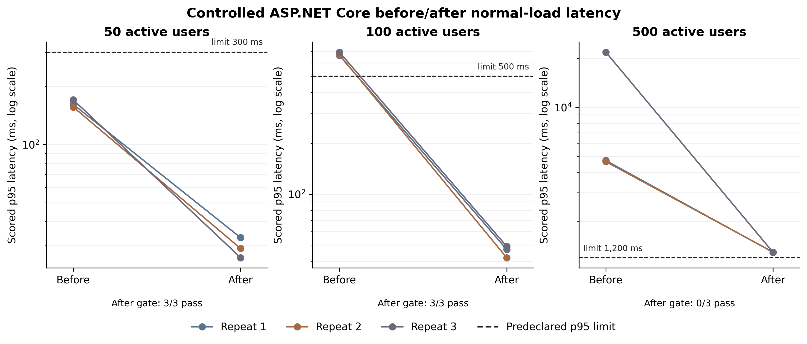

# Controlled cloud JMeter comparison

**Status:** All five profiles have three valid paired repetitions. The raw-file and uniform reanalysis passed on 2026-10-26 (Bangkok time). Both billable VMs have been deleted; the provider showed **$3.10 uninvoiced** at teardown. Final invoice and temporary-token revocation status are reported separately below.

## Method and interpretation

The baseline source is `7a0469d9401a3061941b44fcd46b3beca1c9c729`; the fixed source is `78b08b62570dcf6fe436354e8e6b770ab2074445`. Both ran on the same Singapore 2 Akamai G6 Dedicated 8 GB/4 vCPU target, with an identical separate generator, container CPU and RAM caps, pinned images, JMX files, and synthetic database backup restored before each run. The order was before/after, after/before, before/after for each profile, with three valid paired repetitions. Percent changes below are the **median of the three within-pair percentage changes**, not a percentage calculated from two aggregate medians. Reported medians and ranges describe these three runs; they do not imply statistical significance.

This design follows the reproducibility and cost-reporting concerns of [Papadopoulos et al. (2021)](https://doi.org/10.1109/TSE.2019.2927908), while the spread is retained because [Baresi et al. (2023)](https://doi.org/10.1002/spe.3244) found cloud VM performance can vary by resource, isolation, time, and cost. We report p95 and p99 because slow-tail requests can matter to users even when averages look acceptable, as argued by [Dean and Barroso (2013)](https://doi.org/10.1145/2408776.2408794). Our fixed three-pair count and numerical acceptance thresholds are study choices, not thresholds supplied by those papers; [He et al. (2019)](https://doi.org/10.1145/3338906.3338912) motivates explicit treatment of test variability and cost, but this experiment does not implement their statistical stopping method.

The full timing, resource caps, fixture, concurrency rule, and acceptance gates are in [protocol.md](protocol.md). The post-scoring correction to the concurrency analysis is disclosed in [validity-amendment.md](validity-amendment.md); raw JMeter files and measured latency, throughput, and errors were not changed. Historical March nominal 500-user data had only about 21–22 simultaneous threads, and the September raw JTLs were unavailable, so neither historical set is used as a controlled comparator.

## Normal-load profiles: three valid pairs each

| Profile | Before p95 median (range), ms | After p95 median (range), ms | Median paired p95 change | After performance gate |
| --- | ---: | ---: | ---: | ---: |
| 50 users | 161 (156–170) | 29 (26–33) | −81.41% | 3/3 pass (≤300 ms) |
| 100 users | 670 (663–694) | 47 (42–49) | −92.94% | 3/3 pass (≤500 ms) |
| 500 users | 4,729 (4,657–21,850) | 1,294 (1,293–1,298) | −72.64% | **0/3 pass** (≤1,200 ms) |

The raw paired p95 values, in repeat order, are 161→33, 156→29, and 170→26 ms at 50 users; 663→47, 670→42, and 694→49 ms at 100 users; and 4,729→1,294, 4,657→1,298, and 21,850→1,293 ms at 500 users. Repeats 1 and 3 ran before then after; repeat 2 ran after then before. All three valid pairs are retained, including the slow third 500-user baseline.

*Figure: Each line connects one valid before/after pair. The y-axis is logarithmic so the third 500-user baseline outlier and the lower-load runs remain visible; dashed lines are the predeclared profile p95 limits. Error rates and p99 tradeoffs are reported in the text rather than inferred from this p95-only figure.*

All six source-side groups had 0% scored request errors. At 50 users, both versions passed the 300 ms p95 gate in all three repeats. At 100 users, the baseline failed the 500 ms gate in all three repeats and the fixed source passed in all three. At 500 users, **both versions failed** the 1,200 ms gate in all three repeats, although the fixed source was much faster: its median 1,294 ms remains **94 ms (7.83%) above** that limit. The third 500-user baseline was an extreme slow run, with p95 21,850 ms and throughput 55.94 requests/s versus p95 4,657–4,729 ms and throughput 263.45–265.95 requests/s in the other two. It passed measurement-validity gates; its exact cause is unverified, and it remains in the reported spread.

At 50 users, median paired p99 **increased 23.50%** and bulk-write p95 **increased 9.47%** even though total p95 fell. The p99 side medians were 593 ms before and 578 ms after, but the within-pair p99 changes were **+29.68%, +23.50%, and −46.65%**; the first two repeats worsened, so the predeclared median-of-paired-changes summary is positive. Bulk-write p95 likewise changed **+13.64%, +9.47%, and −32.23%** by pair, worsening in two of three repeats. Reporting both views avoids implying that a ratio of side medians is the paired result. At 100 users, median paired p99 fell 51.75% and throughput rose 37.15%. At 500 users, median paired p99 fell 71.66% and throughput rose 181.22%; the extreme baseline contributes to the range, while the paired median gives each repetition one equal observation. Validity checks confirmed all 500 threads active during the scored hold for each 500-user run; empty JTL request bins were separately recorded as stalls or sampling gaps, not interpreted as missing users.

The largest normal-load changes occur in the report routes targeted by the [source intervention](source-before-after.patch). The table gives the median per-endpoint p95 across the three valid runs on each side; it is descriptive and does not isolate the effect of an individual code change.

| Endpoint | 100 users before → after, ms | 500 users before → after, ms |
| --- | ---: | ---: |
| GET `/reports/account-ledger` | 1,326 → 68 | 9,355 → 1,215 |
| GET `/reports/trial-balance` | 1,183 → 53 | 6,966 → 1,200 |
| GET `/reports/profit-loss` | 1,170 → 58 | 6,855 → 1,140 |
| GET `/reports/balance-sheet` | 1,180 → 53 | 6,879 → 1,267 |
| POST `/journal-entries/bulk` | 422 → 120 | 4,532 → 1,855 |

The after source introduces report-result reuse, account-ledger caching, removal of report snapshot writes, and two composite SQL indexes. These changes occur together in the frozen after commit, so this experiment can compare the combined revision but cannot attribute a numerical gain to any one mechanism. The published index and caching rationale and their limits are explained in [Chapter 2.18's source draft](chapter2-optimization-section-draft.md). Bulk-write latency remains a concern at 500 users, and its 50-user paired p95 change is a regression despite the aggregate speedup.

Resource observations help interpret the limits without proving a single cause. Under the same 2-CPU SQL cap, the median fraction of scored-hold CPU-quota periods throttled was **87.6% before versus 0.4% after** at 100 users, and **86.8% versus 30.7%** at 500 users. At 500 users, the after API container also had a median **12.2%** throttled-period fraction under its 2-CPU cap. The separate JMeter generator's median p95 CPU use at 500 users was **0.96 core out of its 4-core cap** on the after side, and no accepted 500-user run had more than **0.4%** generator throttling. There was no host swap or container OOM kill in the accepted runs. Remaining server-side CPU pressure at 500 users is consistent with the missed 1,200 ms gate; a causal bottleneck diagnosis would need targeted profiling or an intervention that changes one limit at a time.

## Soak: three valid pairs

Across three valid 100-user sustained-load pairs, the median scored-hold p95 fell from **685 ms** (range 672–714) to **50 ms** (42–56), a **92.56% median paired reduction**. Median p99 fell from **1,203 to 652 ms** (median paired change −51.21%), while throughput rose from **286.48 to 400.62 completed requests/s** (median paired change +40.53%). Every scored soak run had **0% request errors**. The source versions and CPU/RAM limits were the same as in the normal profiles, and each run restored the pristine database before starting.

The per-endpoint median soak-hold p95 values across the three valid runs on each side were account ledger **1,270→64 ms**, trial balance **1,203→54 ms**, profit/loss **1,209→59 ms**, balance sheet **1,218→56 ms**, and bulk journal-entry write **404→126 ms**. These are separate side medians, not paired percentage changes; they describe the combined after revision.

The stability result is mixed. Baseline first-to-last ten-minute p95 drift was **10.55%, 11.04%, and 11.06%** (median 11.04%): **3/3 passed** the predeclared ≤20% gate. After drift was **64.10%, 43.90%, and 12.82%** (median 43.90%): **1/3 passed**. The first two after runs rose **39→64 ms** and **41→59 ms** (absolute rises 25 and 18 ms), while their baselines rose **692→765 ms** and **652→724 ms** (73 and 72 ms). The third after run rose only **39→44 ms** and passed. Thus after-fix late-window latency stayed far below baseline in every pair, but the relative stability gate failed in two of three; neither fact cancels the other.

In the first after run, late-window p95 also rose within several endpoints: account ledger 53→79 ms, journal-entry listing 65→134 ms, and bulk journal-entry writes 104→180 ms. The database grew from 30,000 to 70,695 journal entries and accumulated 203,518 audit rows during that run. These are observations, **not** proof that row growth caused the drift. Every run begins from the same backup, but write-heavy throughput produces different within-run database growth. The first two after runs had no host swap or OOM kills and little first-to-last memory change, so the latency drift should not be labeled a memory leak from these data.

## Spike: three valid pairs

Across three valid 100→500→100-user spike pairs, median scored **500-user peak** p95 fell from **4,275 ms** (range 4,274–4,435) to **1,159 ms** (1,131–1,226), a **72.89% median paired reduction**. Median peak p99 fell from **5,867 to 1,877 ms** (paired change −68.01%), and median peak throughput rose from **285.30 to 810.99 completed requests/s** (paired change +184.26%). All six spike runs had **0% scored request errors**. JMeter lifecycle events showed the intended 100 users at base, 500 at peak, and 100 at recovery in every accepted run; the brief 500→100 drain was excluded from scored recovery metrics.

The predeclared recovery gate compares p95 in the 100-user recovery window with the 100-user pre-peak base. Baseline drift was **7.58%, 5.49%, and 11.04%** (median 7.58%): **3/3 passed** the ≤20% gate. After drift was **38.89%, 24.32%, and 81.48%** (median 38.89%): **0/3 passed**. The paired base→recovery p95 values were 633→681 versus 36→50 ms, 674→711 versus 37→46 ms, and 598→664 versus 27→49 ms (before versus after). The after revision recovered to far lower *absolute* latency, but its relative increase from a much lower base exceeded the predeclared gate every time. This stability regression must remain visible alongside the large peak speedup.

Peak-phase per-endpoint median p95 across the three valid runs on each side was account ledger **7,144→1,085 ms**, trial balance **5,580→1,063 ms**, profit/loss **5,478→1,023 ms**, balance sheet **5,476→1,113 ms**, and bulk journal-entry write **3,859→1,681 ms**. These are side medians under the 500-user peak, not a metric from the entire mixed-concurrency run. At the same 2-CPU server-side caps, median SQL CPU-quota throttling during peak fell from **90.61% to 31.89%** of periods; after API throttling was **17.36%**. Generator throttling was at most **0.07%** in any accepted spike run. These measurements support continued server-side CPU pressure at peak without proving that it alone caused any latency value.

## Validity, exclusions, and cost

The comparison program rehashed each accepted raw `run.jtl` and `run.log`, reapplied analysis protocol version 2 uniformly, and confirmed that measured p95/p99, throughput, errors, and drift had not changed during the validity amendment. Every profile has exactly three complete valid pairs, with order before/after, after/before, before/after. The earlier p50 attempt with a missing metrics directory and the incomplete or operator-interfered p500 attempts remain excluded; see [run-exclusions.md](run-exclusions.md) and [validity-amendment.md](validity-amendment.md). The archived March nominal 500-user JTLs showed only about 21–22 simultaneous users; September raw JTLs were unavailable. Those historical figures are **not** combined with the controlled cloud results.

The legacy first-versus-last 20% **of all JTL samples** drift was also calculated and saved in [comparison-data.json](comparison-data.json). It is not the phase-based soak or spike gate: in a 100→500→100 spike, its windows mix different user counts and request compositions. The phase-based gate results above therefore govern stability interpretation.

At server deletion, the Akamai account showed **$3.10 uninvoiced**; this is an accrued account figure, not a settled invoice or a claim that every cent belongs to the experiment. Both experiment VMs were verified absent from the account after deletion, as recorded in [teardown-evidence.json](teardown-evidence.json). The VPC and Cloud Firewall remain because Akamai lists them as free. The final invoice may include hour rounding, taxes, or later adjustment; report it when issued. The local scheduled deletion safeguard was removed after successful manual cleanup. Temporary-token revocation is pending the browser's action-time confirmation.

## Report deliverables

The controlled results and literature interpretation have been incorporated into the [primary Word report](../../outputs/final-report.docx) and [PDF](../../outputs/final-report.pdf), and into the separate [comparison Word report](../../outputs/final-report-gpt55-comparison.docx) and [PDF](../../outputs/final-report-gpt55-comparison.pdf). The latter file retains its existing report structure; its filename should not be treated as new proof of a GPT-5.5 model comparison. The [machine-readable paired summary](comparison-data.json) and [normal-load figure](normal-load-p95.png) support review of the numerical claims. Raw JMeter files, metrics, and hashes remain in the worktree's ignored `.superpowers/sdd/2026-10-23-cloud-jmeter-experiment/evidence/matrix/` directory and were not committed as binary Git history. A separately stored **134.5 MiB** compressed copy is identified, hashed, and counted in [raw-evidence-archive.json](raw-evidence-archive.json), so the raw results can survive later worktree cleanup.
